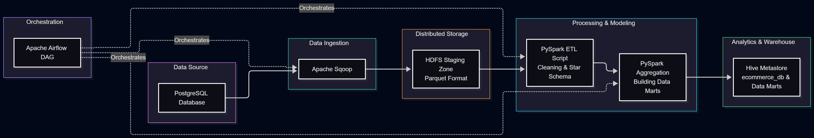
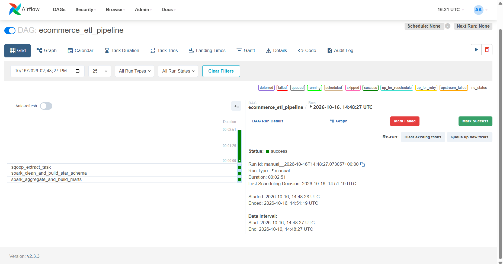
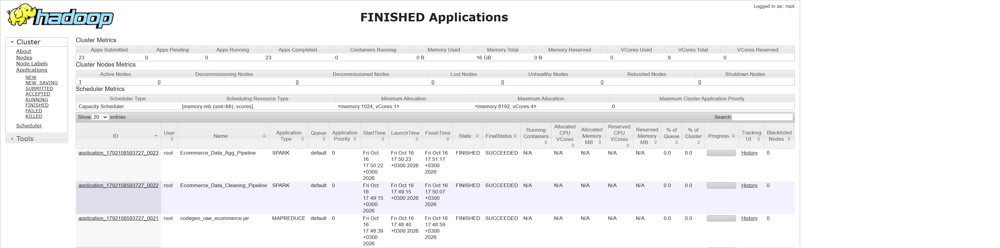
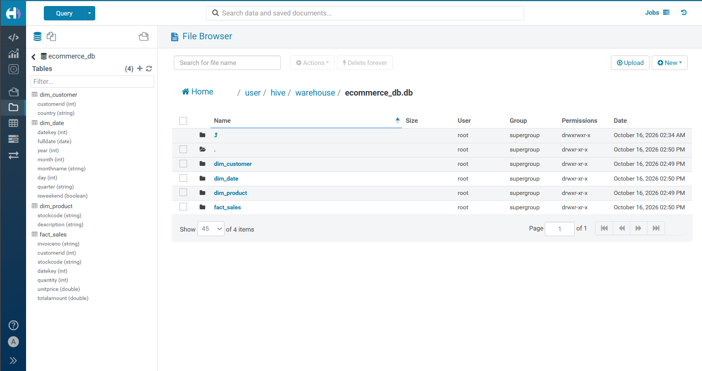
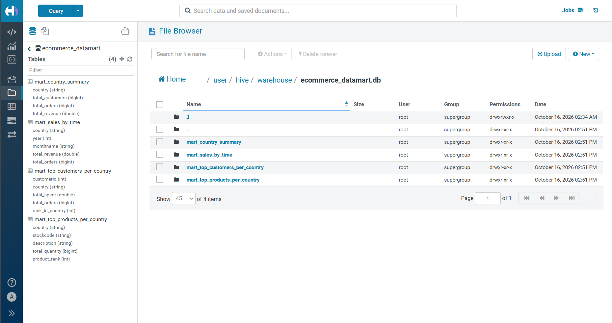
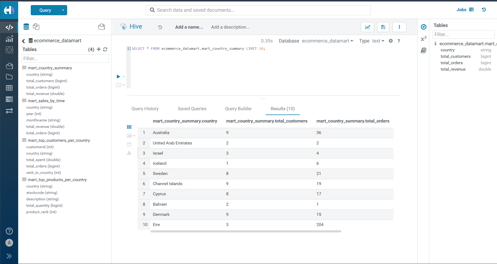
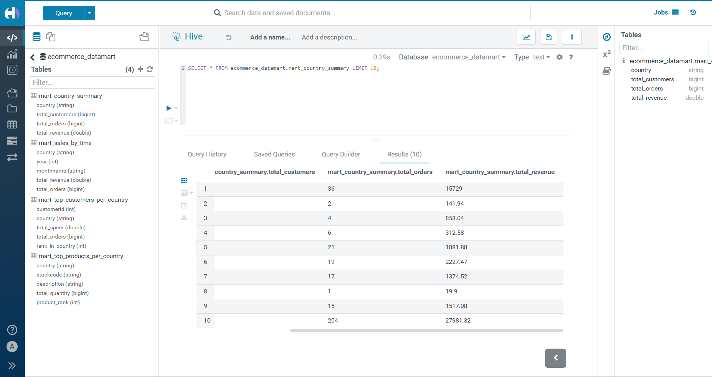

# 🛒 End-to-End E-Commerce Distributed Data Pipeline

An end-to-end distributed data engineering pipeline designed to ingest, clean, model, and aggregate e-commerce data at scale. The pipeline extracts transactional data from **PostgreSQL**, ingests it into **HDFS** via **Apache Sqoop**, processes and constructs a custom **Star Schema** using **PySpark**, builds analytical **Data Marts** in **Apache Hive**, and orchestrates the entire workflow using **Apache Airflow**.

---

## 🏛️ Pipeline Architecture

The overall data workflow and technology stack are illustrated below:



1. **Ingestion Layer:** Ingests raw transactional data from PostgreSQL into HDFS Staging Zone in high-performance Parquet format using **Apache Sqoop**.
2. **Processing & Modeling Layer:** **PySpark** reads raw data, performs data quality checks and cleaning, and constructs a Data Warehouse Star Schema (`fact_sales`, `dim_customer`, `dim_product`, `dim_date`).
3. **Aggregation & Marts Layer:** **PySpark** generates aggregated business metrics and loads them into **Apache Hive Metastore** to support downstream analytics.
4. **Orchestration Layer:** **Apache Airflow** schedules, coordinates, and monitors end-to-end execution across YARN cluster nodes.

---

## 📊 Data Warehousing & Data Marts

### **1. Star Schema Design**
Data is transformed from relational raw format into a optimized Dimensional Star Schema:


* **Fact Table:** `fact_sales` (Sales metrics, revenues, order details)
* **Dimension Tables:** `dim_customer`, `dim_product`, `dim_date`

### **2. Analytical Data Marts**
Built 4 distinct Data Marts in Hive (`ecommerce_datamart` database) for targeted reporting:
* `mart_country_summary`: Geographic sales distribution and revenue by country.
* `mart_sales_by_time`: Revenue and order metrics broken down by year and month.
* `mart_top_customers_per_country`: High-value customer ranking per region.
* `mart_top_products_per_country`: Top-selling products ranked by region.

---

## 🛠️ Tech Stack & Cluster Infrastructure

* **Orchestration:** Apache Airflow
* **Distributed Processing:** Apache Spark (PySpark)
* **Cluster Manager:** Hadoop YARN
* **Data Ingestion:** Apache Sqoop
* **Storage:** Hadoop Distributed File System (HDFS) - Parquet Format
* **Data Warehouse / Metastore:** Apache Hive
* **Source Database:** PostgreSQL

---

## 📸 Pipeline Execution Proof & Verification

### **1. Airflow Orchestration Success**
All DAG tasks (`sqoop_extract_task` $\rightarrow$ `spark_clean_and_build_star_schema` $\rightarrow$ `spark_aggregate_and_build_marts`) completed successfully in sequential order:



### **2. YARN Resource Manager Application Status**
All MapReduce and Spark jobs executed with `FINISHED / SUCCEEDED` status on the YARN cluster:



### **3. HDFS Storage Structure**
Verified underlying storage folders in HDFS for both Data Warehouse and Data Marts databases:

| Warehouse Star Schema Storage (`ecommerce_db`) | Analytical Data Marts Storage (`ecommerce_datamart`) |
| :---: | :---: |
|  |  |

### **4. Hive Analytical Query Results**
Query results from `mart_country_summary` demonstrating aggregated customer counts, orders, and total revenue:

| Hive Mart Results - Metrics | Hive Mart Results - Revenue |
| :---: | :---: |
|  |  |

---

## 📂 Repository Structure

```text
.
├── dags/
│   └── dag_ecommerce.py          # Apache Airflow DAG Definition
├── scripts/
│   ├── clean_ecommerce.py        # PySpark ETL Script (Star Schema)
│   ├── agg_ecommerce.py          # PySpark Aggregations (Data Marts)
│   └── data_profiling.py         # Initial Data Quality & Profiling Script
├── sqoop/
│   └── sqoop_ecommerce.sh        # Sqoop Extraction Shell Script
└── docs/                         # Architecture, Schemas, and Verification Screenshots
